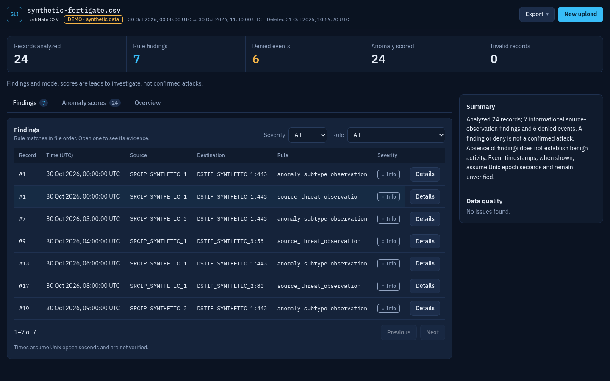
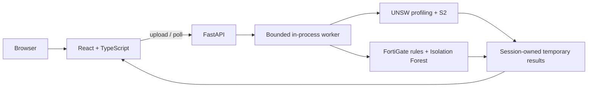

# Security Log Intelligence Web

A web application for exploring supported security logs with source-aware rules and machine learning. Upload a prepared CSV or run a synthetic demo; review evidence, data-quality issues and model output in a dashboard.

**[Open the live demo](https://security-log-intelligence.onrender.com/)** · [Sample data guide](docs/web/sample-data-guide.md) · [API contract](docs/web/api-contract.md) · [Workflow diagram](docs/diagrams/security-log-workflow.drawio) · [PDF](docs/diagrams/security-log-workflow.pdf)


*Development build with synthetic records; screenshots and metrics are not incident evidence.*

## What it does

1. Select **FortiGate CSV** or **UNSW-NB15 prepared CSV**, then upload a matching file or choose **Try synthetic demo**.
2. The API validates the file and starts a bounded analysis job; the frontend polls until it completes.
3. Review the summary, record-level output, model results and data-quality issues. For FortiGate, inspect rule evidence and export findings as CSV or JSON.
4. Switch between retained analyses in the same browser session. Data is temporary and does not survive a service restart.

| Source | Analysis | Interpretation |
| --- | --- | --- |
| FortiGate | Two informational source-observation rules; optional Isolation Forest anomaly scoring using the original frozen reference state. | Findings and relative anomaly percentiles are leads to investigate, not confirmed attacks or attack probabilities. |
| UNSW-NB15 | Descriptive profiling; optional Random Forest BASE-S2 classifies eligible rows as NORMAL or ATTACK. | Uploaded `label`/`attack_cat` are input annotations, separate from predictions. Model scores are not calibrated real-world probabilities. |

The UNSW synthetic demo intentionally exercises both model outputs (4 ATTACK / 8 NORMAL with the verified artifact). Its labels are invented and its feature patterns were selected for demonstration; **it cannot measure model accuracy or F1**.

The historical evaluation panel reports previously published aggregate UNSW-NB15 results. BASE-S2 accuracy is 83.36% and F1 is 86.75% on the historical official test split (82,332 rows). That split was used in earlier project stages and is not newly unseen at the overall project level. These metrics do not evaluate an uploaded file or FortiGate. See `/api/evaluation` for provenance and limitations.

## Architecture



Frontend: React 19, TypeScript, Vite, Tailwind CSS and Recharts. Backend: Python 3.12, FastAPI, Uvicorn and scikit-learn. The current live service runs a private Docker image on Render. Model artifacts and feature state are private runtime assets and are not in Git.

## Limits and responsible use

- Supported inputs are the specified prepared CSV schemas, not arbitrary log formats. Maximum **10 MiB and 50,000 rows** per upload; the upload deadline is 30 seconds.
- One analysis runs at a time, with at most eight retained jobs. Session-owned results expire within 60 minutes and are lost on service restart. There are no user accounts or persistent history yet.
- Invalid rows can be marked `unscored`; missing or unverifiable model assets are reported as unavailable rather than producing fallback predictions. Rules/profiling can remain available.
- This is a portfolio/demo system. **Use synthetic or sanitized data**, not sensitive production logs. The service is not a substitute for an analyst or a production SIEM.
- Free hosting may sleep when idle. The first request can take longer; a restart clears temporary jobs.

## Run locally

Prerequisites: Python 3.12 and a Node.js version compatible with the pinned Vite release (the container uses Node 24). From the repository root:

```bash
python3.12 -m venv .venv
.venv/bin/python -m pip install -r requirements-web.txt -r requirements-inference.txt
npm --prefix web ci
npm --prefix web run build
PYTHONPATH=src .venv/bin/python -m uvicorn web_api.app:create_app --factory --host 127.0.0.1 --port 8000 --workers 1
```

Open `http://127.0.0.1:8000`. Without separately provisioned model artifacts, upload, profiling and rule analysis still work; model panels report unavailable. To enable both models, set `SLI_UNSW_MODEL_DIR` and `SLI_FORTIGATE_MODEL_DIR` to trusted directories containing the exact artifacts described in the [API contract](docs/web/api-contract.md). The application checks their hashes before loading them. Never upload a serialized model through the web app.

For local HTTP, secure cookies default to off; hosted HTTPS uses secure cookies. See the [container guide](docs/web/deploy-container-th.md) before building or publishing an image: it contains the models and must remain private.

### Tests

```bash
.venv/bin/python -m pip install -r requirements-dev.txt
PYTHONPATH=src:tests .venv/bin/python -m pytest -q tests/test_web*.py
npm --prefix web run typecheck
npm --prefix web test
npm --prefix web run build
```

Some integration tests are skipped when their trusted local model bundle is absent. The live UI, private image and deployment should also be smoke-tested after any release.

## Provenance

This web application builds on selected parser, normalization, rules and model-related work from the earlier [Security Log Intelligence](https://github.com/beamtanawat/security-log-intelligence) project. It is a new web application, not a claim that the reused research and model work was created from scratch. See [provenance](docs/provenance.md) and the [API contract](docs/web/api-contract.md).
